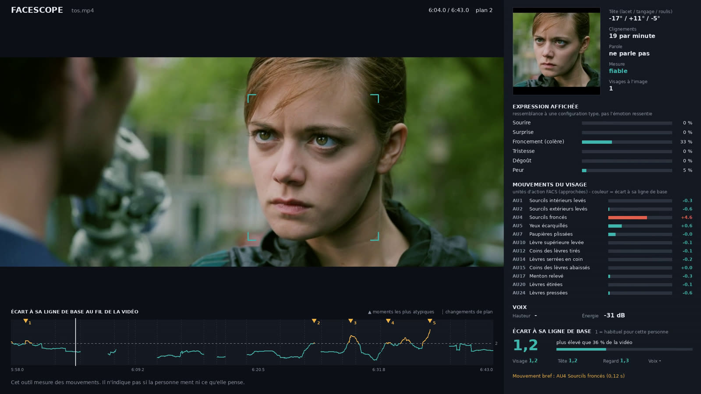

# Facescope

Une vidéo en entrée. En sortie : la même vidéo avec un encadré qui mesure, image par
image, ce que fait le visage de la personne qui parle.

**Ce que l'outil fait.** Il suit le visage, zoome dessus, mesure les mouvements des
muscles, de la tête, du regard et la voix, puis signale les moments où la personne
s'écarte de son propre comportement habituel.

**Ce que l'outil ne fait pas.** Il ne dit pas si la personne ment ni ce qu'elle pense.
La recherche ne valide pas la détection du mensonge par le visage (voir
[RECHERCHE.md](RECHERCHE.md)). Un moment atypique est un endroit où regarder de plus près
et où vérifier ce qui a été dit, rien de plus.

## Installation

```bash
pip install -r requirements.txt
# + ffmpeg ; sous Linux : apt-get install -y ffmpeg libegl1 libgles2
```

## Utilisation

```bash
python -m facescope interview.mp4
python -m facescope interview.mp4 --debut 2:00 --duree 1:30     # un extrait
python -m facescope interview.mp4 --base 0:10-0:40              # passage calme de référence
python -m facescope interview.mp4 --rendu 7:00-8:00             # analyse tout, ne rend qu'un passage
python -m facescope interview.mp4 --format vertical             # rendu 9:16 pour les réseaux sociaux
python -m facescope interview.mp4 --format vertical --analyse analyse.json
```

Trois fichiers sont créés dans `resultats/` :

| Fichier | Contenu |
|---|---|
| `*_facescope.mp4` | La vidéo annotée (1920 x 1080, son d'origine) |
| `*_facescope_vertical.mp4` | Avec `--format vertical` : 1080 x 1920, analyse en haut, vidéo dessous, mesures en bas |
| `*_rapport.json` | Moments atypiques, figements, écarts simultanés, transcription, lexique, limites |
| `*_mesures.csv` | Toutes les mesures, une ligne par image |

Compter environ deux fois la durée de la vidéo (mesuré : 45 s traitées en 1 min 30 sur 4 cœurs).



## Comment ça marche

1. **Plans.** Les changements de plan sont détectés ; le suivi repart de zéro à chacun.
2. **Recherche.** Les visages sont cherchés sur l'image entière, puis par tuiles pour
   trouver les visages lointains.
3. **Zoom.** Chaque visage connu est recadré serré avant analyse. Le visage dominant de
   chaque plan est retenu.
4. **Muscles.** 52 coefficients par image (MediaPipe Face Landmarker), regroupés en
   17 unités d'action proches du système FACS.
5. **Voix.** Hauteur et énergie, comptées seulement quand la personne suivie parle.
6. **Parole.** Transcription horodatée (modèle Whisper, 1,6 Go téléchargés au premier
   lancement), puis débit, silences et hésitations. Le rapport donne aussi le lexique :
   mots fréquents, pronoms, négations, phrases qui citent un chiffre.
7. **Écart.** Chaque signal est comparé à la médiane de la personne dans la vidéo
   (ou dans le passage `--base`). L'indice vaut environ 1 quand tout est habituel ;
   au-dessus de 2, le moment est signalé.

Un **écart simultané** est signalé quand au moins deux familles (visage, mobilité, regard,
voix, parole) dépassent 2 en même temps pendant au moins une seconde.

## Le fichier d'analyse

L'outil mesure ; il ne juge pas le fond. L'analyse du discours et la vérification des faits
se rédigent à part, dans un fichier JSON que le rendu vertical affiche au bon moment :

```json
{"elements": [
  {"debut": 95, "fin": 108, "verdict": "imprécis", "titre": "Chiffre cité",
   "texte": "Ce que dit la personne, puis ce que disent les sources.",
   "source": "Nom de la source, date"}
]}
```

`debut` et `fin` sont en secondes. Verdicts reconnus : exact (vert), inexact (rouge),
trompeur, imprécis, contesté, à nuancer, partiel, incohérence (orange), non vérifiable
(gris). Tout autre mot (discours, lexique…) s'affiche en bleu.

## Lire l'encadré

- **Expression affichée** : ressemblance à une configuration type (sourire, surprise,
  froncement, tristesse, dégoût, peur). Ce n'est pas l'émotion ressentie.
- **Mouvements du visage** : longueur de barre = intensité, couleur = écart à la ligne de
  base (vert habituel, orange au-dessus de 2, rouge au-dessus de 3,5).
- **Écart à sa ligne de base** : l'indice global, son rang dans la vidéo, et le détail
  par famille (visage, mobilité, regard, voix).
- **Mouvement bref** : une unité d'action qui s'active moins d'une demi-seconde.
- **Mobilité** : « figée » quand la tête et le haut du visage bougent nettement moins que
  d'habitude pendant au moins 2 secondes. Les figements sont en bleu sur la courbe.
- **Mesure** : « basse résolution » quand le visage fait moins de 120 pixels de large.
  En dessous de 60 pixels, il n'est pas mesuré du tout.
- **Courbe du bas** : l'indice sur toute la durée, avec les changements de plan et les
  moments les plus atypiques.

## Limites connues

- Une seule personne suivie par plan. Dans une interview à deux, la ligne de base peut
  mélanger le candidat et le journaliste. Tant que ce n'est pas réglé, travailler sur des
  extraits où une seule personne est à l'image.
- Les unités d'action sont approchées par un modèle généraliste, pas codées par un expert.
- À 25 images par seconde, un mouvement de moins de 80 ms n'est vu que sur 1 ou 2 images.
  La compression des vidéos en ligne dégrade encore ce niveau de détail.
- Testé sur un film de fiction (Tears of Steel) et sur trois allocutions politiques en
  640 x 360. À cette résolution le visage fait 53 à 75 pixels : une vidéo est inexploitable,
  les deux autres sont mesurées avec l'alerte « basse résolution ». Il faut du 720p ou du
  1080p pour une mesure fine.
- La précision des mesures n'a pas été comparée à un codage humain. Les seuils (écart,
  figement) sont réglés à la main sur quelques vidéos, pas appris sur des données annotées.
- La transcription automatique efface souvent les « euh » : les hésitations sont
  sous-comptées. Elle peut aussi se tromper sur un mot ou un chiffre.
- L'outil ne vérifie pas les faits lui-même : il affiche l'analyse qu'on lui fournit.

## Suite prévue

1. Reconnaître qui est qui d'un plan à l'autre (ligne de base par personne).
2. Produire le fichier d'analyse automatiquement (extraction des affirmations, recherche
   de sources), avec relecture humaine avant publication.
3. Mesurer la précision sur des extraits annotés par des humains.

## Crédits

Image d'exemple : *Tears of Steel*, (CC) Blender Foundation, mango.blender.org, licence
CC BY 3.0.
