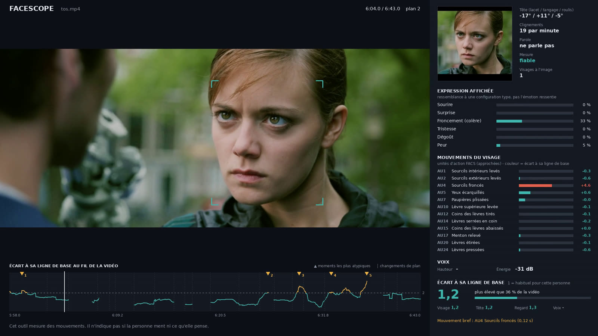

# Facescope

Une vidéo en entrée. En sortie : la même vidéo avec un encadré qui mesure, image par
image, ce que fait le visage de la personne qui parle.

**Ce que l'outil fait.** Il suit le visage, zoome dessus, mesure les mouvements des
muscles, de la tête, du regard et la voix, puis signale les moments où la personne
s'écarte de son propre comportement habituel. Il croise ensuite ces écarts avec ce qui
est dit : passage par passage, le sujet abordé, les canaux qui s'écartent et dans quel
sens. Depuis la 0.5, il sait traiter un débat : il regroupe les visages en personnes (A,
B…), repère qui parle, et donne à chaque personne sa propre ligne de base, ses passages
(quand elle parle, quand elle écoute) et sa synthèse. Depuis la 0.6, il sépare les
participants du public, compare chaque personne à son habitude dans son rôle (parler,
écouter) et ne classe que les thèmes assez longs. Tout est calculé sur l'ordinateur,
sans réseau ni service d'IA (hors téléchargement des quatre modèles au premier lancement).

**Ce que l'outil ne fait pas.** Il ne dit pas si la personne ment ni ce qu'elle pense.
La recherche ne valide pas la détection du mensonge par le visage (voir
[RECHERCHE.md](RECHERCHE.md)). Un moment atypique est un endroit où regarder de plus près
et où vérifier ce qui a été dit, rien de plus.

## Installation

```bash
pip install -r requirements.txt
# + ffmpeg ; sous Linux : apt-get install -y ffmpeg libegl1 libgles2
```

## Utilisation

```bash
python -m facescope interview.mp4
python -m facescope interview.mp4 --debut 2:00 --duree 1:30     # un extrait
python -m facescope interview.mp4 --base 0:10-0:40              # passage calme de référence
python -m facescope interview.mp4 --rendu 7:00-8:00             # analyse tout, ne rend qu'un passage
python -m facescope interview.mp4 --format vertical             # rendu 9:16 pour les réseaux sociaux
python -m facescope interview.mp4 --format vertical --analyse analyse.json   # + vérification des faits
python -m facescope debat.mp4 --debut 7:00 --duree 3:30 --format vertical    # débat : planche des personnes
python -m facescope debat.mp4 --debut 7:00 --duree 3:30 --format vertical --noms "A=Prénom Nom,B=Prénom Nom"
python -m facescope debat.mp4 --debut 7:00 --duree 3:30 --visages photos/   # photos « Prénom Nom.jpg »
python -m facescope debat.mp4 --visages photos/ --sans-video   # rapport et planche seuls, sans vidéo
```

L'analyse croisée est produite à chaque fois, sans fichier à fournir. `--analyse` est
facultatif : il ajoute la vérification des faits rédigée à part (voir plus bas).

Options :

| Option | Effet |
|---|---|
| `--sans-video` | Pas de vidéo annotée : seulement le rapport JSON, la planche des personnes, le CSV et le cache des mesures. Sur le débat entier de 50 min, le rendu vertical prend 39 min ; sans lui, une relance avec cache prend quelques minutes |
| `--noms "A=…,B=…"` | Donne un nom aux participants, par lettre (lettres lues sur la planche `*_personnes.jpg` ; le public n'a pas de lettre) |
| `--visages dossier` | Photos de référence nommées `Prénom Nom.jpg` : la personne la plus proche d'une photo prend son nom (similarité ≥ 0,363, avec 0,05 d'avance sur la suivante) ; `--noms` l'emporte |
| `--recalculer` | Refait l'analyse du visage même si `*_mesures.npz` existe |
| `--debat` | Analyse par personne et attribution de la parole même si une seule personne est reconnue (pour séparer une voix hors champ) |
| `--sans-voix` | Attribue la parole par la bouche seule, sans empreinte vocale |

Les fichiers sont créés dans `resultats/` (ou le dossier `-o`) :

| Fichier | Contenu |
|---|---|
| `*_facescope.mp4` | La vidéo annotée (1920 x 1080, son d'origine) |
| `*_facescope_vertical.mp4` | Avec `--format vertical` : 1080 x 1920, analyse croisée en haut, vidéo dessous, courbe et mesures brutes en bas |
| `*_rapport.json` | Moments atypiques, figements, écarts simultanés, croisement (passages et synthèse), transcription, lexique, limites ; depuis la 0.5, `personnes` (une entrée par personne), `locuteurs`, `identite` |
| `*_mesures.csv` | Toutes les mesures, une ligne par image (visage dominant de chaque plan, comme en 0.4) |
| `*_personnes.jpg` | La planche des personnes : une ligne par participant (lettre, nom s'il est donné, temps à l'image, temps de parole, une vignette par piste pour vérifier le regroupement), puis le public (une vignette par personne, avec son temps à l'image), puis les autres visages |
| `*_mesures.npz` | Les mesures de tous les visages, image par image : relues au lancement suivant si la vidéo, le début, la durée, le nombre de visages et la version du format n'ont pas changé |
| `*_transcription_*.json` | La transcription, relue elle aussi au lancement suivant |

En fin d'exécution, la commande affiche la synthèse : pour une personne seule, comme en
0.4 ; pour un débat, par personne (temps à l'image et de parole, moments atypiques,
thèmes où elle s'anime ou se retient en parlant, puis en écoutant) et la parole par
locuteur.

L'analyse du visage prend une à deux fois la durée de l'extrait (mesuré : 3 min 30 de
débat en 5 min 46, deux visages et plus par image). Grâce à `*_mesures.npz`, une relance
pour nommer les personnes ou rendre un autre passage ne la refait pas (13 s au lieu de
5 min 46 sur le même extrait, sans rendu vidéo).



## Comment ça marche

1. **Plans.** Les changements de plan sont détectés ; le suivi repart de zéro à chacun.
2. **Recherche.** Les visages sont cherchés sur l'image entière, puis par tuiles pour
   trouver les visages lointains.
3. **Zoom.** Chaque visage connu est recadré serré avant analyse. Tous les visages suivis
   sont gardés (jusqu'à `--max-visages`, 4 par défaut).
4. **Muscles.** 52 coefficients par image (MediaPipe Face Landmarker), regroupés en
   17 unités d'action proches du système FACS.
5. **Voix.** Hauteur et énergie, comptées seulement quand la personne suivie parle.
6. **Parole.** Transcription horodatée (modèle Whisper, 1,6 Go téléchargés au premier
   lancement), puis débit, silences et hésitations. Le rapport donne aussi le lexique :
   mots fréquents, pronoms, négations, phrases qui citent un chiffre.
7. **Écart.** Chaque signal est comparé à la médiane de la personne dans la vidéo
   (ou dans le passage `--base`). L'indice vaut environ 1 quand tout est habituel ;
   au-dessus de 2, le moment est signalé.
8. **Croisement.** La parole est découpée en passages de 4 à 15 secondes (phrases,
   ponctuation, silences ; fenêtres de 8 s sans transcription). Chaque passage reçoit un
   sujet, ses écarts par canal, une orientation et une phrase de lecture (détail ci-dessous).

Un **écart simultané** est signalé quand au moins deux familles (visage, mobilité, regard,
voix, parole) dépassent 2 en même temps pendant au moins une seconde.

## Débat : qui est qui, qui parle

**Qui est qui** (`identite.py`). Pendant le suivi, chaque piste (un passage continu du
même visage dans un plan) reçoit des empreintes faciales : visage d'au moins 48 pixels,
tourné de moins de 30°, une toutes les 0,5 s. Les pistes sont regroupées par
regroupement hiérarchique (lien moyen) sur la distance cosinus : deux groupes sont réunis
tant que leur distance moyenne reste sous 0,6 ; deux pistes vues ensemble au moins 3
images ne sont jamais réunies. Un groupe vu moins de 4 s, ou une piste sans empreinte
(toujours de profil ou trop petite), va dans « autres ». **L'outil ne devine aucune
identité** : il ne connaît que les lettres, les noms donnés par `--noms` et les photos
fournies par `--visages`. Les lettres dépendent de l'extrait : elles peuvent changer d'un
extrait à l'autre.

Deux garde-fous (0.6), qui marchent aussi sans photos :

- **Pistes coupées.** Le suivi rattache un visage à la piste ouverte au même endroit de
  l'image. Quand deux plans cadrés pareil s'enchaînent dans le même décor, la coupe peut
  passer inaperçue et une piste passer d'une personne à l'autre (débat Maréchal–Villepin :
  deux pistes commencées sur le présentateur continuaient sur Villepin, et leur vignette
  le montrait sur la ligne du présentateur). Une piste est coupée là où ses empreintes
  changent de personne : similarité moyenne entre les 3 empreintes d'avant et les 3
  d'après sous 0,25 (minimum local), à l'image où le cadre du visage saute le plus. Sur
  ce débat, 94 % des paires d'empreintes consécutives dépassent 0,7, et les changements
  observés donnaient -0,05 à 0,15. Deux morceaux de la même personne se retrouvent au
  regroupement. Le rapport liste les coupures (`identite.pistes_coupees`).
- **Réaffectation.** Après le regroupement, une piste nettement plus proche d'une autre
  personne que de la sienne (0,1 de similarité d'avance, et au moins 0,4) y est déplacée,
  sauf si elle est vue en même temps qu'une piste de cette personne
  (`identite.reaffectations`).

**Participants et public** (débat avec transcription). Un **participant** est une personne
nommée par une photo (`--visages`), ou qui parle vraiment : la parole est d'abord attribuée
avec toutes les personnes reconnues comme candidates, et une personne qui en reçoit au
moins 5 s et au moins 1 % de la parole attribuée de l'extrait est participante. Les autres
forment le **public** : pas de lettre, pas d'analyse, pas d'étiquette dans la vidéo, pas de
parole. La parole est ensuite attribuée à nouveau entre les seuls participants (avec les
mêmes empreintes vocales) ; un morceau que seule la bouche d'une personne du public
désignait, et qu'aucun participant ne reprend, reste « indéterminé ». Le public apparaît à
part sur la planche et dans le rapport (`public` : nombre, temps à l'image, parole reçue
avant l'exclusion). Les lettres A, B… ne sont données qu'aux participants, par temps à
l'image ; `--noms` s'applique à ces lettres. Sans transcription, ou si personne n'est nommé
ni au-dessus du seuil, toutes les personnes reconnues restent participantes (comme en 0.5).

Pourquoi 1 % : sur le débat Maréchal–Villepin (50 min, environ 2 740 s de parole
attribuée), les huit personnes du public assises derrière les candidats recevaient 0 à
8,4 s chacune en 0.5 (0,3 % au plus : leur mâchoire bouge pendant qu'un candidat parle
hors champ), le présentateur 74,6 s (2,7 %), les candidats plus de 1 000 s. 1 % (27 s ici)
laisse une marge d'un facteur 3 de chaque côté. Le plancher de 5 s sert aux courts
extraits, où 1 % ne fait que 1 ou 2 s. Un intervenant qui parle moins que ce seuil tombe
dans le public : une photo de référence le garde participant.

**Qui parle** (`locuteurs.py`). Chaque morceau de phrase transcrit est attribué :
1. par la bouche : parmi les personnes dont le visage est mesurable sur au moins 25 % des
   images des mots, celle dont la mâchoire bouge sur au moins 50 % de ses images, avec 20
   points d'avance sur la suivante ; deux bouches qui bougent : « indéterminé » ; aucune :
   « voix hors champ » ;
2. par la voix (sauf `--sans-voix`) : la voix d'une personne est la moyenne des
   empreintes vocales des morceaux que la bouche lui attribue (au moins 3 morceaux et
   6 s). Un morceau d'au moins 1 s dont la voix lui ressemble (similarité ≥ 0,5, avec 0,2
   d'avance sur la voix suivante) lui est attribué, même hors champ ou quand deux bouches
   bougent. Une voix qui ne ressemble à aucune personne reconnue reste « voix hors champ ».

Les passages sont coupés à chaque changement de locuteur. Chaque passage porte son
locuteur, et chaque personne à l'image son rôle : **parle**, **écoute** (avec le nom de
qui parle s'il est connu), « parole non attribuée », « sans parole ».

**Analyse par personne** (`personnes.py`). Chaque participant a sa vue (ses seules
pistes), sa ligne de base calculée sur ses propres images fiables, et sa parole (débit,
silences, voix) calculée sur ses seuls tours de parole. Sous 20 s d'images fiables,
l'outil écrit « pas assez de données » au lieu de calculer.

**Habitude par rôle** (0.6). On bouge moins en écoutant qu'en parlant : avec une seule
habitude, parole et écoute confondues, l'écoute sortait « se retient » par construction
(en 0.5, Villepin sur 73 de ses 123 passages d'écoute, Maréchal sur 50 de 134, par le
figement et la baisse de mobilité). Chaque image est donc comparée à l'habitude de la
personne dans son rôle à ce moment : ses tours de parole d'un côté, tout le reste (elle
écoute) de l'autre. Cela vaut pour le visage, la mobilité de la tête et du haut du visage,
le figement, le regard et les clignements ; la voix et la parole n'étaient déjà mesurées
que pendant ses tours. Si un rôle a moins de 20 s d'images fiables, il garde l'habitude
globale, et le rapport le dit (`ligne_de_base.par_role`, `repli`). Le mode une seule
personne ne change pas. Pour qui parle, tous les critères de
l'orientation comptent ; pour qui écoute, seuls le visage, la mobilité et le regard. La
synthèse d'une personne sépare les thèmes sur lesquels elle s'anime ou se retient en
parlant, et en écoutant.

**Une seule personne reconnue** : l'analyse est exactement celle de la 0.4 (visage
dominant de chaque plan, toute la parole lui est comptée), et l'entrée `personnes` du
rapport reprend ces résultats. Les clés de la 0.4 (`ligne_de_base`, `moments_atypiques`,
`croisement`…) gardent dans tous les cas leur sens de la 0.4 (visage dominant de chaque
plan) ; dans un débat, lire `personnes`.

## Le croisement

Pour chaque passage, le rapport (`croisement.passages`) donne :

- **ce qui est dit** : le texte, un ou deux thèmes reconnus par une liste de mots-clés
  (quinze thèmes : pouvoir d'achat, énergie, sécurité, immigration, éducation, santé,
  retraites, emploi, impôts et dette, écologie, international, institutions, justice,
  logement, agriculture), sinon les trois mots les plus distinctifs du passage, et si un
  chiffre est cité ;
- **ce que montrent les mesures**, sur les seules images fiables : écart moyen et maximal,
  rang dans la vidéo, écart par canal (visage, mobilité, regard, voix, parole), signal
  principal de chaque canal avec son signe, moments atypiques, figement, écart simultané,
  débit et plus long silence comparés à l'habitude de la personne ;
- **l'orientation**, avec chaque critère, sa valeur et son seuil (`criteres`), pour qu'on
  puisse la contester ;
- **la lecture**, une phrase du type « Sujet : international et défense. Sourcils
  extérieurs levés (+5,9) : la personne s'anime. Écart 1,1, plus élevé que 75 % de la
  vidéo. »

**Règle d'orientation.** Chaque critère compare un écart signé à l'habitude de la personne
(en dispersions), moyenné sur les images fiables du passage :

| S'anime | Se retient |
|---|---|
| tête ou haut du visage plus mobiles ≥ +1,5 | figement sur au moins 25 % du passage, ou tête ou haut du visage moins mobiles ≤ -1,5 |
| voix plus aiguë ≥ +1,5 | regard détourné ≥ +1,5 |
| voix plus forte ≥ +1,5 | plus long silence du passage ≥ +4 et d'au moins 2 s |
| débit plus rapide ≥ +1,5 | débit plus lent ≤ -1,5 |
| unité du haut du visage ou coins des lèvres ≥ +5 | hésitations ≥ +1,5 |

Dans un passage qui contient un moment atypique, les seuils sont divisés par deux : le
moment montre déjà que la personne s'écarte, il reste à dire dans quel sens. Le seuil
appliqué est écrit dans chaque critère du rapport. La durée minimale de 2 s du silence long
n'est jamais divisée : l'écart du silence a un plancher de 0,2 s, et une pause de 1,3 s
l'atteignait déjà. Sur un passage sans parole transcrite,
débit, silence et hésitations ne sont pas évalués (le canal Parole affiche « pas de
parole ») ; ailleurs, débit et hésitations ne sont lus qu'à l'intérieur des phrases.

Aucun critère atteint : **habituel**. Critères d'un seul sens : **s'anime** ou **se
retient**. Les deux sens : **mixte**, sauf si l'un compte au moins deux critères de plus.
Moins de 30 % d'images fiables, ou trop peu pour calculer un écart moyen : **non mesuré**.
Les seuils sont réglés à la main pour que, sur une allocution lue, environ un passage sur
trois au plus sorte de « habituel » (29 % mesurés, dont tous les passages à moment
atypique) ; ils ne sont pas validés sur des extraits annotés.

**Synthèse** (`croisement.synthese`) : par thème, le temps de parole, l'écart moyen, la
part du temps au-dessus du seuil de 2 et l'orientation dominante ; les thèmes où la
personne s'anime ou se retient le plus ; les passages les plus marqués avec leur
horodatage. La règle et ses seuils sont recopiés dans `croisement.regle`.

**Classement des thèmes** (0.6). Un thème n'entre au classement (`classement`,
`plus_marques`, console, bloc « SUJETS LES PLUS MARQUÉS » du rendu vertical) qu'avec au
moins **30 s et 3 passages mesurés**. 30 s, c'est deux passages de durée maximale (15 s) :
aucun passage seul ne pèse plus de la moitié du temps du thème, et un « 100 % » demande
au moins trois passages concordants. En 0.5 (8 s, sans minimum de passages), « santé :
s'anime 100 % du temps » sortait en tête pour Villepin sur 13 s. Un thème trop court reste
dans `themes` avec `classe: false` et la raison (`hors_classement`). Si aucun thème ne
passe, la console et le bloc du rendu vertical l'écrivent (« aucun sujet assez long ») et
montrent les passages les plus marqués.

## Le fichier d'analyse

L'outil mesure et croise ; il ne juge pas le fond. La vérification des faits se rédige à
part, dans un fichier JSON facultatif que le rendu vertical affiche au bon moment, en bas
du bloc d'analyse :

```json
{"elements": [
  {"debut": 95, "fin": 108, "verdict": "imprécis", "titre": "Chiffre cité",
   "texte": "Ce que dit la personne, puis ce que disent les sources.",
   "source": "Nom de la source, date"}
]}
```

`debut` et `fin` sont en secondes. Verdicts reconnus : exact (vert), inexact (rouge),
trompeur, imprécis, contesté, à nuancer, partiel, incohérence (orange), non vérifiable
(gris). Tout autre mot (discours, lexique…) s'affiche en bleu. Hors des éléments du
fichier, ou sans fichier, le bas du bloc affiche les sujets les plus marqués de la vidéo.

## Lire l'encadré

**Rendu vertical.** Le bloc d'analyse, en haut, reste fixe pendant tout un passage :

- **Personne lue** (à côté de « ANALYSE ») : son nom ou sa lettre, et son rôle (PARLE,
  ÉCOUTE suivi de qui parle). C'est la personne qui parle si elle est à l'image, sinon le
  plus grand visage à l'image ; tout le bloc, la courbe et la bande des mesures brutes
  portent sur elle.
- **Pastille** : orientation du passage. S'anime (orange), se retient (bleu), mixte
  (violet), habituel (gris), non mesuré. À côté, l'écart moyen du passage et son rang :
  « plus élevé que 63 % de la vidéo » veut dire que 63 % des images de la vidéo ont un
  écart plus faible. À droite, les repères de la courbe tombés sur ce passage (moment
  atypique, écart simultané, figement).
- **Sujet** : les thèmes reconnus, sinon les mots marquants ; « cite un chiffre » quand
  le passage en contient un. Dessous, ce qui est dit.
- **Écart par canal** : une ligne par canal (visage, mobilité, regard, voix, parole). Barre
  et valeur : écart moyen du canal (1 = habituel, trait vertical à 2) ; couleur verte sous
  2, orange au-dessus, rouge au-dessus de 3,5. À droite, le signal qui s'écarte le plus,
  en mots et avec son signe (« sourcils extérieurs levés +4,1 », « débit plus lent -1,2 »).
- **Autres personnes à l'image** (débat), une ligne chacune, deux au plus : « B écoute :
  se retient, regard détourné +2,1 » (orientation de cette personne sur le passage,
  calculée avec ses propres signaux, et son critère le plus fort). Pour qui écoute, les
  canaux Voix et Parole affichent « non compté (écoute) ».
- **Lecture** : la phrase qui résume le passage.
- **Bas du bloc** : l'élément du fichier `--analyse` en cours, sinon les trois sujets les
  plus marqués de la personne lue (en parlant, sinon en écoutant ; pour une personne
  seule : de la vidéo).
- **Visages** : chaque cadre porte la lettre ou le nom de la personne (vert : personne
  lue, gris : les autres ; le public et les visages « autres » n'ont pas d'étiquette). Sur la courbe,
  qui suit la personne lue, les moments atypiques portent sa lettre (« A2 »).
- **Légende** : « S'anime : peut traduire de l'intérêt ou de la conviction. Se retient :
  peut traduire de la gêne ou de la prudence. L'outil montre l'écart, pas sa cause. »

Sous la vidéo, la **courbe** donne l'écart sur toute la durée (changements de plan,
moments atypiques numérotés, figements en bleu, écarts simultanés en rouge, éléments
d'analyse en couleur de verdict) ; un cadre gris entoure le passage affiché. La **bande
des mesures brutes** montre le visage zoomé, l'expression affichée dominante (moyenne
sur une seconde), les clignements, la voix, la tête, le débit et la qualité de la mesure.

**Rendu paysage.** Inchangé depuis la 0.4 : il suit le visage dominant de chaque plan,
sans lettre ni rôle. Pour un débat, préférer le rendu vertical. Il garde les colonnes
détaillées :

- **Expression affichée** : ressemblance à une configuration type (sourire, surprise,
  froncement, tristesse, dégoût, peur). Ce n'est pas l'émotion ressentie.
- **Mouvements du visage** : longueur de barre = intensité, couleur = écart à la ligne de
  base (vert habituel, orange au-dessus de 2, rouge au-dessus de 3,5).
- **Écart à sa ligne de base** : l'indice global, son rang dans la vidéo, et le détail
  par famille (visage, mobilité, regard, voix, parole).
- **Mouvement bref** : une unité d'action qui s'active moins d'une demi-seconde.
- **Mobilité** : « figée » quand la tête et le haut du visage bougent nettement moins que
  d'habitude pendant au moins 2 secondes. Les figements sont en bleu sur la courbe.
- **Mesure** : « basse résolution » quand le visage fait moins de 120 pixels de large.
  En dessous de 60 pixels, il n'est pas mesuré du tout.
- **Courbe du bas** : l'indice sur toute la durée, avec les changements de plan et les
  moments les plus atypiques.

## Limites connues

- Débat (0.5), testé sur deux extraits seulement (3 min 30 de Maréchal/Villepin, 3 min de
  Lisnard/Roussel avec un modérateur). Les regroupements y étaient justes ; l'attribution
  de la parole, contrôlée à la main sur 14 morceaux du premier, a donné 12 justes, 2 non
  attribués, aucun faux. Ce n'est pas une validation. En 0.6, le débat Maréchal–Villepin
  entier (50 min) a servi à régler le public, les pistes coupées et l'habitude par rôle :
  3 participants (les deux candidats et le présentateur), 8 personnes du public ; en
  écoutant, « se retient » passe de 73 à 21 passages sur environ 130 pour Villepin et de
  50 à 19 pour Maréchal. En parlant, « se retient » augmente (25 à 46, 10 à 32) : pour
  moitié par la parole réattribuée (silences, hésitations), pour moitié parce que les
  moments calmes en parlant ne sont plus masqués par la comparaison avec l'écoute. Ces
  passages n'ont pas été relus un à un.
- Regroupement : deux personnes très semblables peuvent être réunies ; une personne
  toujours de profil ou lointaine reste dans « autres » ; un visage vu sur un écran du
  plateau est compté avec la personne qu'il montre. Le public assis derrière les
  candidats est regroupé en personnes, puis mis à part comme public s'il ne parle pas
  (0.6) ; une personne du public dont la bouche bouge longtemps pendant qu'un candidat
  parle hors champ pourrait dépasser le seuil et devenir participante.
- Pistes coupées (0.6) : un changement de personne de moins de deux empreintes (environ
  1 s) dans une piste n'est pas vu ; un morceau isolé mal mesuré (flou, de biais) peut être
  coupé à tort, puis il rejoint d'ordinaire sa personne au regroupement.
- Parole : quand deux personnes parlent en même temps, la transcription ne garde qu'une
  voix et le morceau peut rester « indéterminé » ; une interruption à l'intérieur d'une
  phrase n'est pas séparée ; un morceau de moins d'une seconde n'a pas d'empreinte
  vocale. Une personne dont la bouche n'est jamais vue parler n'a pas de voix connue : ce
  qu'elle dit hors champ reste « voix hors champ ». Une voix inconnue proche d'une voix
  connue pourrait lui être attribuée (seuil 0,5 et avance 0,2 pour s'en protéger).
- Avec une seule personne reconnue, toute la parole lui est comptée, même celle d'un
  journaliste hors champ (comme en 0.4) : `--debat` pour la séparer.
- Les unités d'action sont approchées par un modèle généraliste, pas codées par un expert.
- À 25 images par seconde, un mouvement de moins de 80 ms n'est vu que sur 1 ou 2 images.
  La compression des vidéos en ligne dégrade encore ce niveau de détail.
- Testé sur un film de fiction (Tears of Steel) et sur trois allocutions politiques en
  640 x 360. À cette résolution le visage fait 53 à 75 pixels : une vidéo est inexploitable,
  les deux autres sont mesurées avec l'alerte « basse résolution ». Il faut du 720p ou du
  1080p pour une mesure fine.
- La précision des mesures n'a pas été comparée à un codage humain. Les seuils (écart,
  figement) sont réglés à la main sur quelques vidéos, pas appris sur des données annotées.
- La transcription automatique efface souvent les « euh » : les hésitations sont
  sous-comptées. Elle peut aussi se tromper sur un mot ou un chiffre.
- Les thèmes sont reconnus par une liste de mots-clés : un sujet abordé sans ces mots
  n'est pas reconnu, un mot-clé peut apparaître hors sujet (« jeunes », « travail »,
  « gouvernement » sont fréquents), et un passage reçoit au plus deux thèmes.
- L'orientation (s'anime, se retient, mixte, habituel) suit une règle réglée à la main sur
  une allocution lue et quatre minutes d'une déclaration. Elle n'a pas été validée sur des extraits annotés par
  des humains : c'est une description de la direction de l'écart, pas un diagnostic, et
  elle ne dit rien de la cause (intérêt, agacement, gêne, concentration, lecture d'un texte).
- La voix n'est mesurée que lorsque la bouche de la personne suivie bouge. Sur un visage
  petit ou peu net, ce repérage peut échouer et le canal voix rester presque vide (observé
  sur 4 minutes de l'interview testée, visage médian de 66 pixels : parole repérée sur
  0,3 % des images).
- L'outil ne vérifie pas les faits lui-même : il affiche l'analyse qu'on lui fournit.

## Suite prévue

1. Valider l'orientation, le regroupement et l'attribution de la parole sur 20 à 30
   extraits annotés par des humains, dont des débats.
2. Produire le fichier de vérification des faits automatiquement (extraction des
   affirmations, recherche de sources), avec relecture humaine avant publication.

## Modèles et crédits

Téléchargés une fois dans `~/.cache/facescope`, depuis une adresse fixe ; les deux
modèles d'empreinte sont contrôlés par leur empreinte SHA-256 à chaque lancement.

| Modèle | Source | Taille | Licence |
|---|---|---|---|
| Visage (MediaPipe Face Landmarker) | storage.googleapis.com (Google) | 3,7 Mo | Apache 2.0 (non revérifiée en 0.5) |
| Transcription (Whisper large-v3-turbo, faster-whisper) | Hugging Face | 1,6 Go | MIT (non revérifiée en 0.5) |
| Empreinte faciale SFace 2021dec | github.com/opencv/opencv_zoo (commit ba91a3b) | 38,7 Mo | Apache 2.0 |
| Empreinte vocale WeSpeaker ResNet34-LM | huggingface.co/Wespeaker/wespeaker-voxceleb-resnet34-LM (commit f0c48c2) | 26,5 Mo | CC BY 4.0 (attribution requise : « WeSpeaker, wenet-e2e ») |

SFace : le dépôt OpenCV Zoo ne nomme pas les données d'entraînement. WeSpeaker est
entraîné sur VoxCeleb (voix de personnalités tirées de YouTube). Les deux licences
permettent un usage commercial ; aucune n'est « non commerciale ».

Image d'exemple : *Tears of Steel*, (CC) Blender Foundation, mango.blender.org, licence
CC BY 3.0.
